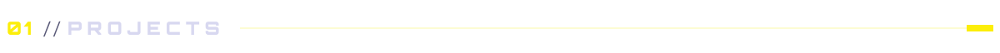
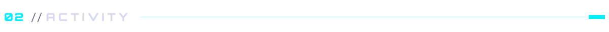
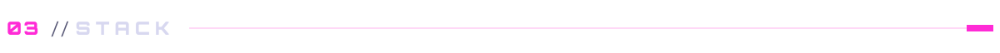
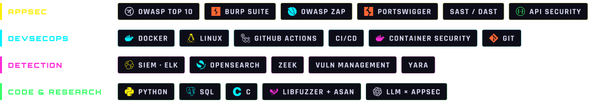
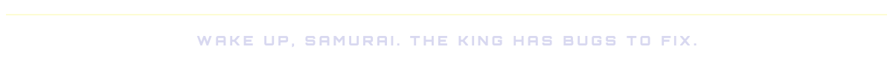

<div align="center">
  

  <br/>

  <a href="#projects"><b>Projects</b></a> &nbsp;·&nbsp;
  <a href="#activity"><b>Activity</b></a> &nbsp;·&nbsp;
  <a href="#stack"><b>Stack</b></a>
</div>

<br/>

```console
$ whoami
kirill alimov  ·  aka whiteking
application security  ·  web & api security  ·  secure code review
4th-year infosec student @ RTU MIREA  ·  open to an appsec internship
```

<a name="projects"></a>


<a href="https://github.com/GodFobos/Appsec-DevSecOps-Intensive">
  
</a>

A 26-week track I started in October 2026, from fundamentals to junior AppSec / DevSecOps.
Every topic ends the same way: **break it, then fix it**.

`OWASP Top 10` &nbsp; `API security & access control` &nbsp; `Secure SDLC: SAST / SCA / DAST in CI`

<br/>

<a href="https://github.com/GodFobos/fuzzing-playground">
  
</a>

Coverage-guided fuzzing of small C parsers with **libFuzzer + AddressSanitizer**. Every harness written by hand.

| Target | Status |
| --- | --- |
| `benhoyt/inih` | done: 57M+ executions, 0 crashes |
| `hsnborn22/C-json` | in progress |
| `LloydLabs/librini` | next |

Goal: find a real bug and report it through responsible disclosure.

<br/>

<a name="activity"></a>



<br/>

<a name="stack"></a>




<br/>


